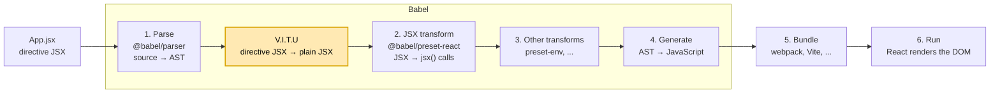
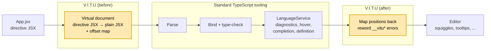
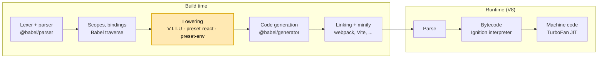
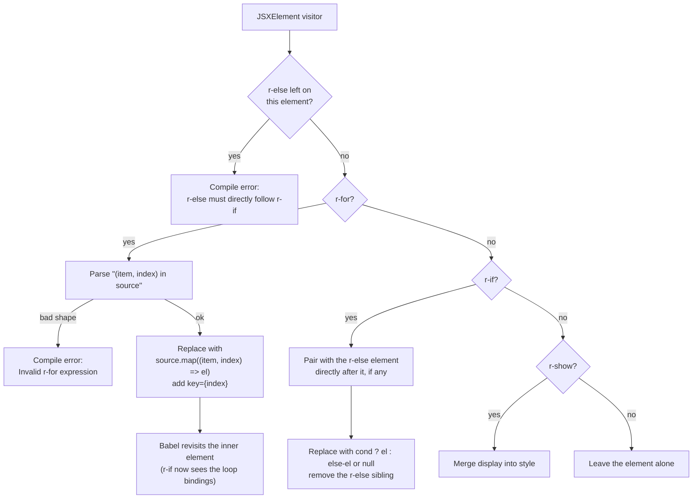
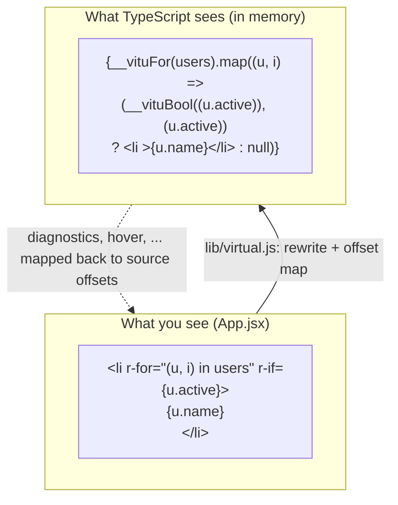
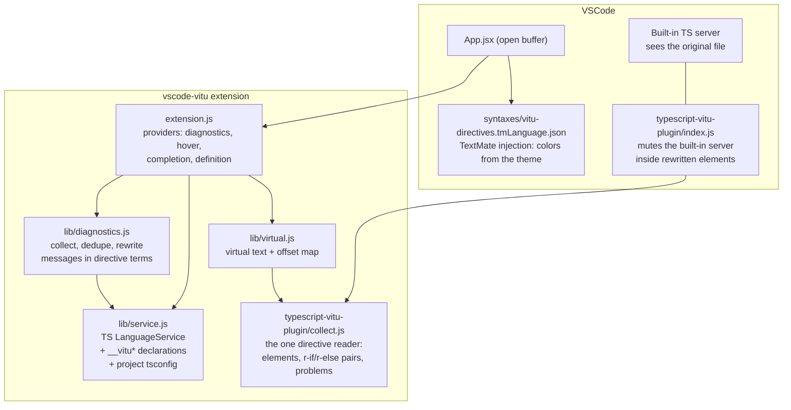
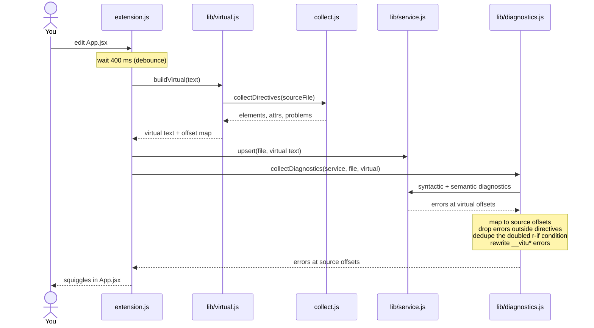
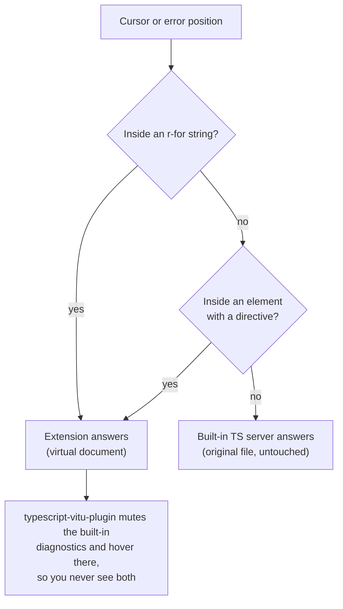

# How V.I.T.U works

This page explains the idea behind V.I.T.U and how its two halves, the Babel
plugin and the VSCode extension, work together. The decisions behind the
design are in [DEVLOG.md](DEVLOG.md).

## The idea

React has no template language: a condition is a `? :`, a list is a `.map()`.
V.I.T.U lets you write Vue-style directives as JSX attributes instead.

V.I.T.U does not replace any part of the usual React toolchain. It adds **one
step in front of it**: directive JSX goes in, plain JSX comes out, and from
there the standard pipeline runs exactly as it would on hand-written JSX.
Nothing is added to the bundle.

### At build time

The standard React build (parse, JSX transform, generate, bundle, render) is
unchanged. V.I.T.U runs on the AST right after parsing, before the JSX
transform of `@babel/preset-react`:



Example of what each step sees:

| Step | Code |
| --- | --- |
| Source | `<li r-for="(u, i) in users">{u.name}</li>` |
| after V.I.T.U | `{users.map((u, i) => <li key={i}>{u.name}</li>)}` |
| after the JSX transform | `users.map((u, i) => jsx("li", { children: u.name }, i))` |
| Bundle and run | ordinary React code; React never sees a directive |

Babel actually merges the visitors of all plugins into one traversal. The
order still holds: plugins run before presets, and V.I.T.U rewrites each
element on the way in, while the JSX transform compiles it on the way out.

### At edit time

The editor follows the same principle. The standard path is: source,
TypeScript LanguageService, editor features. The extension adds a step in
front of TypeScript that turns directive JSX into the same plain JSX Babel
would produce (the **virtual document**), and a step after it that maps the
answers back to the source positions. TypeScript itself is not modified:



The rule that holds the design together: **the editor checks exactly the code
that will run.** The extension never type-checks the directive syntax itself;
it rewrites the file the way Babel would, and lets TypeScript check the
result.

### Why a step in front, not a new pipeline

The design follows the SOLID principles that apply to a build step:

- **Single responsibility.** V.I.T.U only rewrites directives into plain JSX.
  Compiling JSX, down-levelling syntax, bundling, rendering and type-checking
  stay with the tools that already do them.
- **Open/closed.** The toolchain is extended by adding a step, not by
  changing Babel, `@babel/preset-react` or TypeScript. Removing V.I.T.U leaves
  a working pipeline.
- **Substitutable output.** What V.I.T.U hands on is plain JSX, the same
  contract the next step already accepts from hand-written code. Nothing
  downstream needs to know V.I.T.U exists.
- **One definition per side.** The Babel plugin and the editor each read
  directives in one place (`scripts/index.cjs`, `collect.js`), and the two
  must agree.

## Background: where V.I.T.U sits in a compiler

### Why a compile step at all

Browsers only run JavaScript. JSX is not JavaScript either, so React code
always goes through a compile step, with or without V.I.T.U.

A directive cannot be handled at runtime instead (for example by wrapping
`createElement` and reading an `r-for` prop):

```jsx
<li r-for="(item, i) in items">{item.name}</li>
```

JavaScript evaluates `{item.name}` **before** any function that creates the
`<li>` is called. At that point `item` does not exist, so the code throws a
`ReferenceError` before any runtime helper could step in. `r-for` introduces
**a new variable** around the element body, and only rewriting the code
before it runs can do that. This is also why Vue has a template compiler.

### Why Babel

Babel is a **transpiler**, a source-to-source compiler: JS/JSX in, JS out. It
was chosen because:

1. **It is usually already in a React toolchain** to compile JSX. V.I.T.U is
   one more plugin, not a new tool, which is what "a step in front" means.
2. **It has a plugin API over the AST**, with scope and binding information,
   so a transform takes a few hundred lines.
3. **Plugins run before presets**, so V.I.T.U sees JSX before
   `@babel/preset-react` turns it into `jsx()` calls.

Babel is not the only option, and depending on it has a cost:

| Tool | Custom AST transforms |
| --- | --- |
| Babel | Yes, JavaScript API, easy to write; slower than the two below |
| SWC (Next.js default) | Yes, but written in Rust and compiled to wasm |
| esbuild (Vite in dev) | No transform API over the AST |
| TypeScript `tsc` | Transformer API exists, rarely wired into builds |

A Next.js project on SWC has to switch Babel back on to use V.I.T.U;
supporting SWC directly would mean porting the plugin to Rust.

### The parts of a compiler

A classic compiler has three blocks:

```text
source code
  │  FRONT END: understand the code
  ├─ 1. Lexer / scanner     characters → tokens   (`const`, `x`, `=`, `1`)
  ├─ 2. Parser              tokens → AST          (syntax tree)
  ├─ 3. Semantic analysis   scopes, bindings, types
  │  MIDDLE END: transform
  ├─ 4. Lowering / IR       rewrite high-level syntax into simpler forms
  ├─ 5. Optimization        dead code, constant folding, ...
  │  BACK END: produce output
  ├─ 6. Code generation     IR → machine code / bytecode / other source
  └─ 7. Linking             combine many files into one program
```

- An **interpreter** stops after step 3 (or 4, with bytecode) and **executes**
  directly instead of producing a file.
- A **compiler** runs every step and produces an artifact that runs later.
- A **JIT** mixes the two: it interprets first, then compiles hot code to
  machine code while the program runs.

### The same steps in a JavaScript toolchain

For JavaScript these steps are spread over two moments, build time and
runtime:

| When | Tool | Compiler step |
| --- | --- | --- |
| Build | Babel: parse | 1–2 (lexer and parser) |
| Build | Babel: traverse + `path.scope` | 3 (scopes, bindings) |
| Build | **V.I.T.U**, `preset-react`, `preset-env` | 4 (lowering, also called *desugaring*) |
| Build | Babel: generate (+ source maps) | 6 (code generation, to JavaScript) |
| Build | webpack / Vite / Rollup | 7 (linking: resolve imports, tree-shake) and 5 (minify) |
| Runtime | V8 (Chrome, Node): parse → bytecode → Ignition interpreter → TurboFan JIT | steps 1–6 again, down to machine code |



In these terms V.I.T.U is **one desugaring pass** in the middle end. Every
compiler has passes like it: `for...of` lowered to an iterator loop,
`a?.b` lowered to `a == null ? undefined : a.b`. V.I.T.U does the same with
`r-for` → `.map()` and `r-if` → `? :`. It does not parse, generate code or
bundle, which is what keeps it a single responsibility.

The editor side has the same shape. The TypeScript compiler is a scanner,
parser, binder, checker and emitter; the extension reuses the scanner, parser,
binder and checker, and skips the emitter. What V.I.T.U adds there is the same
desugaring pass (the virtual document), placed in front of TypeScript's
parser.

## The directives

| You write | Babel emits |
| --- | --- |
| `<p r-if={ok}>A</p><p r-else>B</p>` | `{ok ? <p>A</p> : <p>B</p>}` |
| `<p r-show={open}>A</p>` | `<p style={{ display: open ? '' : 'none' }}>A</p>` |
| `<li r-for="(u, i) in users">{u.name}</li>` | `{users.map((u, i) => <li key={i}>{u.name}</li>)}` |

## Half 1: the Babel plugin

`scripts/index.cjs` visits every JSX element once. Each visit handles at most
one directive and replaces the element; Babel then visits the replacement,
which is how an element with both `r-for` and `r-if` gets both.



Every misuse stops the build with a code frame instead of producing broken
output (`r-if="ok"`, `r-for={items}`, an orphan `r-else`, …).

## Half 2: the VSCode extension

### The problem

To TypeScript, the source file is ordinary JSX. `"(u, i) in users"` is a
string, `u` in the element body is an undefined variable, and `r-if` is an
unknown attribute. Asking TypeScript about the original file gives wrong
answers.

### The fix: a virtual document

The extension uses the same technique as Volar does for Vue: it builds a
**virtual copy** of the file where every directive is rewritten into the code
Babel would produce, runs TypeScript on that copy, and maps the answers back.



Two helpers, declared in a virtual `.d.ts`, carry the type rules that the
runtime relies on:

- `__vituFor(source)` accepts arrays only, because the runtime calls `.map`.
- `__vituBool(cond)` requires a boolean, like the `r-if?: boolean` attribute
  type. The condition is emitted twice: once inside `__vituBool` to check it,
  once as the real `? :` test so TypeScript **narrows** types in the body.

### The pieces



`collect.js` is shared by the extension and the tsserver plugin, so the editor
has a single definition of what a valid directive is. It must match the Babel
plugin, and it reports misuse with the same wording as Babel's compile errors.

### From a keystroke to a red squiggle



### How offsets are mapped

The virtual text is built piece by piece, and every piece records where it
came from. For `<li r-for="(u, i) in users">{u.name}</li>`:

| Virtual text, in order | Kind | Comes from in the source |
| --- | --- | --- |
| `{` | generated | nothing |
| `__vituFor(` | glue | the whole `r-for` attribute |
| `users` | segment | `users` inside the string |
| `).map((` | glue | the whole `r-for` attribute |
| `u` | segment | `u` inside the string |
| `, ` | glue | the whole `r-for` attribute |
| `i` | segment | `i` inside the string |
| `) => ` | glue | the whole `r-for` attribute |
| `<li ` | ident chunk | `<li ` |
| `>{u.name}</li>` | ident chunk | `>{u.name}</li>` |
| `)}` | generated | nothing |

The attribute itself is not copied; only its expressions come back, as
segments. That is why hover and go-to-definition work on `u`, `i` and `users`
inside the string.

| Piece | What it is | An error here is reported on |
| --- | --- | --- |
| **segment** | a directive expression moved into code (`users`, `u.active`) | the same characters in the source; if the error covers the whole expression, the message is rewritten ("r-for expects an array, got …") |
| **ident chunk** | source copied verbatim (the element and its body) | the same characters, but only inside a rewritten element |
| **glue** | generated code with no source (`__vituFor(`, `.map(`) | the whole directive attribute |
| **scope** | the range of an element that was rewritten | (decides who answers, see below) |

### Who answers where

Two TypeScript services run on the same file: VSCode's built-in one, which
sees the original text, and the extension's, which sees the virtual one. Each
position has exactly one owner:



Outside directive elements the extension stays silent, so the rest of the file
behaves exactly as it does without V.I.T.U. `tsc` and CI are unaffected: the
tsserver plugin only lives in the editor.

## Where to look

| Question | File |
| --- | --- |
| How is a directive compiled? | [scripts/index.cjs](scripts/index.cjs) |
| What counts as a valid directive in the editor? | [vscode-vitu/typescript-vitu-plugin/collect.js](vscode-vitu/typescript-vitu-plugin/collect.js) |
| What does TypeScript actually see? | [vscode-vitu/lib/virtual.js](vscode-vitu/lib/virtual.js) |
| Where do the error messages come from? | [vscode-vitu/lib/diagnostics.js](vscode-vitu/lib/diagnostics.js) |
| Why does the built-in server stay quiet? | [vscode-vitu/typescript-vitu-plugin/index.js](vscode-vitu/typescript-vitu-plugin/index.js) |
| How are directives colored? | [vscode-vitu/syntaxes/vitu-directives.tmLanguage.json](vscode-vitu/syntaxes/vitu-directives.tmLanguage.json) |
